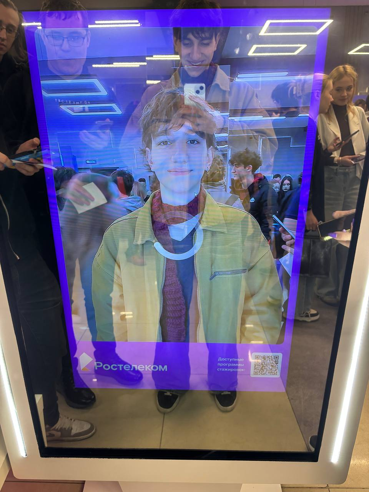
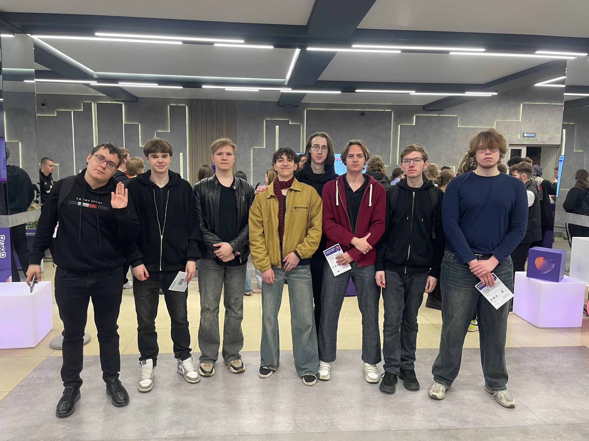
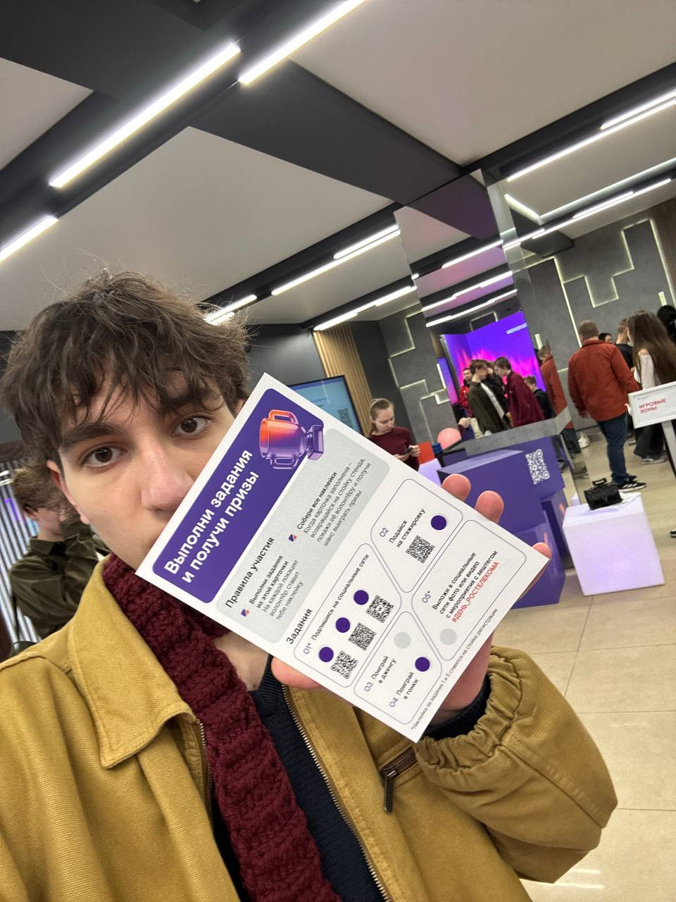

# Отчёт о взаимодействии с организацией-партнёром

## Общая информация

В рамках проектной (учебной) практики было посещено мероприятие  
«День карьеры Ростелекома в Московском Политехе».

Мероприятие было направлено на знакомство студентов с современными
IT-направлениями, карьерными возможностями, стажировками и
технологическими решениями компании Ростелеком.

Дата посещения: 7 апреля в 11:00 на Большой Семёновской, 38. 2026 г.  
Место проведения: Московский Политех.

---

# Описание мероприятия

В рамках мероприятия были организованы несколько тематических треков:

## Обучающий трек

Были проведены лекции и мастер-классы от специалистов Ростелекома,
посвящённые:

- современным IT-инфраструктурам;
- сетевым технологиям;
- принципам работы интернета;
- облачным платформам;
- информационной безопасности;
- применению искусственного интеллекта в бизнесе.

Особенно полезной оказалась информация о том, как устроена
инфраструктура сетевых сервисов и каким образом организуется
передача данных между клиентом и сервером.

Также были рассмотрены реальные примеры эксплуатации крупных
распределённых систем и особенности поддержки высоконагруженных сервисов.

---

## Карьерный трек

Во время карьерного трека удалось:

- получить консультации от рекрутеров;
- узнать требования к junior backend-разработчикам;
- принять участие в пробном интервью;
- получить рекомендации по составлению резюме;
- ознакомиться с программами стажировок и практик.

На демо-собеседовании были рассмотрены:

- базовые вопросы по backend-разработке;
- основы работы HTTP;
- принципы клиент-серверного взаимодействия;
- использование Git и систем контроля версий;
- навыки командной разработки.

Также была получена информация о стажировках в направлениях:

- backend-разработка;
- DevOps;
- сетевые технологии;
- аналитика данных;
- искусственный интеллект.

---

## Развлекательный трек

Дополнительно на мероприятии были представлены:

- AI-стенды;
- интерактивные зоны;
- профессиональный автосимулятор;
- игровые пространства;
- фотозоны;
- зоны отдыха и общения.

Участники могли ознакомиться с современными технологиями,
используемыми в IT-индустрии, а также протестировать различные
интерактивные решения.

---

# Полученные знания и навыки

В результате участия в мероприятии были получены следующие знания и навыки:

- понимание структуры современной IT-компании;
- представление о процессе прохождения технического интервью;
- навыки коммуникации с HR-специалистами;
- понимание требований к начинающим backend-разработчикам;
- знания о сетевой инфраструктуре и принципах работы интернета;
- представление о стажировках и карьерных возможностях в IT.

Также был получен опыт взаимодействия с представителями
реального бизнеса и понимание того, какие навыки востребованы
в индустрии в настоящий момент.

---

# Связь мероприятия с проектом

Полученные знания напрямую связаны с проектом AI-WorkShop,
так как в рамках проекта изучаются:

- backend-технологии;
- архитектура клиент-серверных приложений;
- искусственный интеллект;
- современные AI-инструменты;
- командная разработка.

Информация о сетевых технологиях и backend-инфраструктуре
будет полезна при дальнейшей разработке программных решений
и проектировании серверной части приложений.

Навыки прохождения интервью и понимание карьерных требований
также являются важной частью профессионального развития
backend-разработчика.

---

# Фотографии с мероприятия

## Фото 1

---

## Фото 2

---

## Фото 3

---

# Итоги

Посещение «Дня карьеры Ростелекома» позволило получить
практическое представление о работе IT-компаний,
карьерных возможностях и современных технологиях,
используемых в индустрии.

Мероприятие оказалось полезным как с точки зрения
профессионального развития, так и для дальнейшей работы
над проектом AI-WorkShop.
